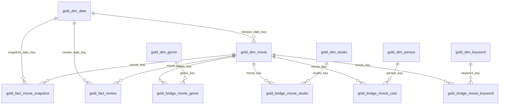

# TMDB Movie Analytics Lakehouse

A Databricks and PySpark lakehouse project that ingests movie catalog data from **The Movie Database (TMDB) API** and processes it through Bronze, Silver, and Gold layers. Gold is a star schema with conformed dimensions, two fact tables, and bridge tables for the many-to-many relationships.

## Team

- Munam Ansari
- Sanan Zahid

## Project Domain

Entertainment and media analytics: movie budgets, revenue, ratings, genres, production companies, cast, keywords, and reviews.

## Data Source

- **API:** [TMDB API v3](https://developer.themoviedb.org/reference/intro/getting-started)
- **Full load:** `/discover/movie`, enriched per movie with credits, keywords, and reviews.
- **Incremental load:** `/movie/changes` over a configurable date window, followed by fetching the changed movie records.

## Repository Structure

```text
.
├── data/
│   ├── full_load/
│   └── incremental_load/
├── scripts/
│   ├── fetch_full_load.py
│   ├── fetch_incremental_load.py
│   └── requirements.txt
├── notebooks/
│   ├── tmdb_data_fetch.ipynb
│   ├── phase2_incremental_autoload.ipynb
│   ├── phase2_schema_contract_test.ipynb
│   ├── phase2_raw_to_bronze.ipynb
│   ├── phase2_bronze_to_silver.ipynb
│   ├── phase2_silver_child_tables.ipynb
│   ├── phase2_silver_reviews.ipynb
│   └── phase3_gold_dimensional.ipynb
└── docs/
    ├── Phase1_Project_Proposal_TMDB_Lakehouse.docx
    └── gold_dimensional_model.md
```

## Implemented Scope

- **Bronze:** Retains raw movie JSON and ingestion/source metadata in Delta.
- **Silver:** Parses data using explicit PySpark schemas, validates records, flattens nested collections, and performs Delta `MERGE` operations.
- **Gold:** Dimensional star schema over Silver: conformed dimensions (`date`, `movie` SCD2, `genre`, `studio`, `person`, `keyword`), bridge tables for the many-to-many links, and two fact tables (`gold_fact_movie_snapshot`, `gold_fact_review`). Built automatically at the end of the incremental pipeline.

The Phase 2 notebooks use a `batch_id` parameter to select the Bronze batch to process. Logical keys are validated and used for merges; Delta does not enforce primary-key constraints.

## Data Models

The tables below are in the Databricks namespace `workspace.tmdb_lakehouse`. Types use Spark/Delta SQL notation. All Bronze and Silver tables include `load_timestamp`, as do both Gold facts; Gold dimensions use `valid_from`/`valid_to` for history instead.

### Bronze

**Table:** `bronze_movie_records`  
**Grain:** One row per movie per input batch  
**Logical key:** (`batch_id`, `movie_id`)

| Column | Type | Description |
|---|---|---|
| `batch_id` | STRING | Input batch identifier. |
| `movie_id` | BIGINT | TMDB movie identifier. |
| `load_type` | STRING | `full` or `incremental`. |
| `raw_payload` | STRING | Original movie JSON used for downstream parsing and reprocessing. |
| `source_file` | STRING | Source file path. |
| `source_extracted_at` | TIMESTAMP | Source snapshot timestamp used for lineage and ordering. |
| `window_start` | DATE | Incremental change-window start; NULL for full loads. |
| `window_end` | DATE | Incremental change-window end; NULL for full loads. |
| `load_timestamp` | TIMESTAMP | Time the record was written to Bronze. |

### Silver movie table

**Table:** `silver_movies_cleansed`  
**Grain:** One current cleaned record per movie  
**Logical key:** `movie_id`

| Column | Type | Description |
|---|---|---|
| `movie_id` | BIGINT | TMDB movie identifier. |
| `imdb_id` | STRING | IMDb identifier, when available. |
| `title` | STRING | Movie title. |
| `original_title` | STRING | Original-language title. |
| `overview` | STRING | Movie overview. |
| `original_language` | STRING | Original-language code. |
| `release_date` | DATE | Parsed date; blank or invalid values become NULL. |
| `runtime` | INT | Runtime in minutes. |
| `status` | STRING | TMDB status. |
| `adult` | BOOLEAN | Adult-content indicator. |
| `video` | BOOLEAN | Video indicator. |
| `popularity` | DOUBLE | TMDB popularity value. |
| `vote_average` | DOUBLE | Average TMDB rating. |
| `vote_count` | BIGINT | Number of votes. |
| `budget` | BIGINT | Positive budget; zero or negative values become NULL. |
| `revenue` | BIGINT | Positive revenue; zero or negative values become NULL. |
| `profit` | BIGINT | Revenue minus budget when both values are available. |
| `roi` | DOUBLE | (Revenue - budget) / budget when both values are available. |
| `budget_tier` | STRING | `low` (< $10M), `medium` ($10M to < $100M), `high` (>= $100M); NULL if budget is unknown. Thresholds are nominal USD. |
| `source_batch_id` | STRING | Batch that supplied the current movie state. |
| `source_file` | STRING | Source file path. |
| `source_extracted_at` | TIMESTAMP | Source snapshot timestamp. |
| `row_hash` | STRING | SHA-256 hash of business fields for change detection. |
| `load_timestamp` | TIMESTAMP | Time the Silver row was created or materially updated. |

### Silver child tables

Each child-table row also has `source_batch_id STRING`, `source_file STRING`, `source_extracted_at TIMESTAMP`, `row_hash STRING`, and `load_timestamp TIMESTAMP`.

| Table | Grain and logical key | Additional business columns |
|---|---|---|
| `silver_movie_genres` | Movie–genre; (`movie_id`, `genre_id`) | `genre_name STRING` |
| `silver_movie_studios` | Movie–production company; (`movie_id`, `company_id`) | `company_name STRING`, `origin_country STRING` |
| `silver_movie_cast` | Movie–cast credit; (`movie_id`, `credit_id`) | `person_id BIGINT`, `cast_name STRING`, `character STRING`, `cast_order INT` |
| `silver_movie_keywords` | Movie–keyword; (`movie_id`, `keyword_id`) | `keyword_name STRING` |

The key columns are BIGINT except `credit_id`, which is STRING. Every child table also includes `movie_id BIGINT` and its other key column (`genre_id`, `company_id`, or `keyword_id`) as BIGINT.

### Silver reviews table

**Table:** `silver_movie_reviews`  
**Grain:** One row per movie review  
**Logical key:** (`movie_id`, `review_id`)

| Column | Type | Description |
|---|---|---|
| `movie_id` | BIGINT | Parent movie identifier. |
| `review_id` | STRING | TMDB review identifier. |
| `reviewer_hash_id` | STRING | Salted SHA-256 hash of reviewer identity; NULL if identity is unavailable. |
| `content` | STRING | Review text with email addresses and URLs scrubbed. |
| `created_at` | TIMESTAMP | Review creation time. |
| `updated_at` | TIMESTAMP | Review update time. |
| `rating` | DOUBLE | Reviewer rating, when available. |
| `weeks_since_release` | INT | Floor of elapsed seven-day periods between release and review; NULL if release date is unavailable. |
| `source_batch_id` | STRING | Source Bronze batch. |
| `source_file` | STRING | Source file path. |
| `source_extracted_at` | TIMESTAMP | Source snapshot timestamp. |
| `row_hash` | STRING | Hash of review business fields. |
| `load_timestamp` | TIMESTAMP | Silver processing timestamp. |

Raw reviewer names, usernames, avatar paths, and review URLs are not written to Silver. The reviewer hash salt is stored in Databricks Secrets; never commit or print its value.

### Gold

Gold is built by `phase3_gold_dimensional.ipynb`. It does not copy Silver: it conforms entities into surrogate-keyed dimensions, separates descriptive attributes from measures, and records facts at an explicit grain. The full data dictionary is in [`docs/gold_dimensional_model.md`](docs/gold_dimensional_model.md).

| Table | Type | Grain | Keys |
|---|---|---|---|
| `gold_dim_date` | dimension | One row per calendar day (1900–2100) | **PK** `date_key` |
| `gold_dim_movie` | dimension, SCD Type 2 | One row per movie per attribute version | **PK** `movie_key`; natural `movie_id`; **FK** `release_date_key` |
| `gold_dim_genre` | dimension, SCD Type 1 | One row per genre | **PK** `genre_key`; natural `genre_id` |
| `gold_dim_studio` | dimension, SCD Type 1 | One row per production company | **PK** `studio_key`; natural `company_id` |
| `gold_dim_person` | dimension, SCD Type 1 | One row per cast member | **PK** `person_key`; natural `person_id` |
| `gold_dim_keyword` | dimension, SCD Type 1 | One row per keyword | **PK** `keyword_key`; natural `keyword_id` |
| `gold_bridge_movie_genre` | bridge | Movie version × genre | **PK/FK** (`movie_key`, `genre_key`) |
| `gold_bridge_movie_studio` | bridge | Movie version × studio | **PK/FK** (`movie_key`, `studio_key`) |
| `gold_bridge_movie_cast` | bridge | Movie version × credit | **PK/FK** (`movie_key`, `credit_id`); **FK** `person_key` |
| `gold_bridge_movie_keyword` | bridge | Movie version × keyword | **PK/FK** (`movie_key`, `keyword_key`) |
| `gold_fact_movie_snapshot` | fact, periodic snapshot | One row per movie per snapshot date | **PK** `snapshot_key`; **FK** `movie_key`, `snapshot_date_key` |
| `gold_fact_review` | fact, transaction | One row per review | **PK** `review_key`; **FK** `movie_key`, `review_date_key` |



Modeling notes:

- `gold_dim_movie` is **SCD Type 2** over `title`, `original_title`, `original_language`, `release_date`, `runtime`, `status`, `adult`, and `budget_tier`. Surrogate key `movie_key = xxhash64(movie_id, version)`; `valid_from` / `valid_to` / `is_current` track history, and `attribute_hash` prevents rewriting unchanged rows.
- Budget, revenue, profit, ROI, votes, popularity, and the child-collection counts are **measures**, so they live in `gold_fact_movie_snapshot`, not on the dimension.
- The four bridge tables are factless fact tables. A movie has many genres, studios, cast members, and keywords, so those links cannot sit on the movie dimension.
- `reviewer_hash_id` on `gold_fact_review` is a **degenerate dimension**: the reviewer has no descriptive attributes worth modeling.
- Delta does not enforce keys. The notebook inner-joins the current dimension version when building facts and bridges, so orphan keys cannot be inserted.

### Operational tables

- **`pipeline_execution_logs`** records one row per execution: `run_id`, `layer`, `load_type`, `input_parameter`, `batch_id`, `start_time`, `end_time`, `status`, `rows_inserted`, `rows_updated`, `rows_quarantined`, `error_details`, and `load_timestamp`. Gold appends one row per step with `layer = 'Silver-to-Gold'`; the step name and its source tables are stored in `input_parameter`, and `rows_inserted` + `rows_updated` is the number of aggregated Gold rows produced.
- **`pipeline_quarantine`** records rejected-record metadata: `quarantine_id`, `layer`, `batch_id`, `source_file`, `source_extracted_at`, `record_key`, `reason`, `record_hash`, and `quarantined_at`. Raw payloads are not copied into this table.
- **`silver_child_snapshot_state`** tracks the processed snapshot per `movie_id` and collection using `collection_name`, `source_extracted_at`, `source_batch_id`, and `load_timestamp`.

## Pipeline Behavior

### Schema enforcement and quarantine

- Raw JSON is read and parsed with explicit `StructType` and `StructField` schemas; Spark schema inference is not used.
- Movie records with invalid required fields are written to quarantine and excluded from Silver. Deterministic quarantine identifiers make retries duplicate-safe.
- Additive fields not present in the explicit schema remain in the raw Bronze payload and are ignored by the current Silver model.
- Synthetic testing confirmed an additive field could be parsed without breaking the record, while a non-numeric movie ID was quarantined.
- Quarantine behavior has been implemented and tested for the movie pipeline. Child and review validation currently stops processing on invalid required fields rather than routing those rows through the movie quarantine flow.

### Idempotency and snapshot handling

- Delta `MERGE` operations use the logical keys listed above.
- Reprocessing the same batch and snapshot does not insert duplicate rows or update unchanged records.
- Movie snapshots are ordered by `source_extracted_at`; an older snapshot cannot overwrite newer Silver data, and equally timestamped different batches are rejected as ambiguous.
- A complete, successfully parsed child collection replaces that movie’s stored child set. A valid empty array can remove stale child rows; a missing or unparsed collection is not treated as empty.
- Reviews use upserts. Rows are not deleted merely because they are absent from a response, since TMDB review results may be paginated.
- Child stale-row deletions are reported by the notebooks, but the execution-log schema records inserted, updated, and quarantined counts—not a deletion count.

## Running Loads and Backfills

1. Run the Raw-to-Bronze notebook with the input path, `load_type`, `batch_id`, `source_extracted_at`, and, for incremental loads, the change-window parameters.
2. In the movie, child-table, and reviews notebooks, set the `batch_id` widget to the desired Bronze batch.
3. Run each notebook from the top so it reads and validates the selected batch before merging.
4. To backfill, select the historical Bronze batch and run the same Silver notebooks. Preserve its source snapshot timestamp; do not replace it with the current processing time.
5. Run `phase3_gold_dimensional.ipynb` with the same `batch_id` (blank selects the latest Silver batch) to refresh the Gold dimensions and facts.

For a recurring incremental load, skip steps 1–2 and run `phase2_incremental_autoload.ipynb`, described below; it chains Silver and Gold for you.

The repository’s sample files do not provide reliable real extraction timestamps. For the Phase 2 ordering demonstration only, the full batch was assigned `2026-10-10 00:00:00` and the incremental batch `2026-10-10 00:01:00`. These are simulated test timestamps, not verified TMDB extraction times. That alignment runs only when the `demo_timestamp_align` widget in `phase2_bronze_to_silver` is set to `true`; it defaults to `false` so scheduled runs never rewrite real snapshot times.

## Automating the Incremental Load

`notebooks/phase2_incremental_autoload.ipynb` replaces the manual Colab-fetch, upload, and Raw-to-Bronze loop. One run calls `/movie/changes`, fetches the changed movie records, writes the wrapped JSON to a Unity Catalog volume, and then invokes `phase2_raw_to_bronze` with the matching widgets.

1. Store the TMDB API key once. It is read from Databricks Secrets and never committed:

   ```powershell
   databricks secrets create-scope tmdb-lakehouse-secrets
   databricks secrets put-secret tmdb-lakehouse-secrets tmdb-api-key
   ```

2. Run the notebook. It creates `workspace.tmdb_lakehouse` and the `raw` volume when they are missing, then loads the batch into Bronze.

   | Widget | Default | Meaning |
   |---|---|---|
   | `raw_output_dir` | `/Volumes/workspace/tmdb_lakehouse/raw/incremental` | Base folder; each batch is written to `<dir>/<batch_id>/movies_incremental_load.json`. |
   | `lookback_days` | `7` | Change window in days; TMDB accepts at most 14. |
   | `max_movies` | `300` | Upper bound on movies fetched per run. |
   | `batch_id` | blank → `incremental-YYYYMMDD` | Bronze batch identifier. |
   | `run_silver` | `false` | Also run the movie, child-table, and review Silver notebooks. |
   | `run_gold` | `true` | After Silver, run `phase3_gold_dimensional` to refresh the Gold star schema. Ignored when `run_silver=false`. |
   | `api_key` | blank | Optional override for the secret; leave blank in normal use. |

3. To run it on a schedule: **Workflows → Create job → Notebook task**, select this notebook, add a schedule (for example daily at 06:00 UTC), and create. Keep `run_silver=false` when Silver should be reviewed separately.

Behavior notes:

- When the change feed returns no IDs, the notebook exits with `NO_CHANGES:<start>:<end>` before writing a file or merging anything.
- `/movie/changes` is limited to 500 pages (10,000 IDs) and returns HTTP 400 for page 501. The notebook stops paging as soon as `max_movies` unique IDs are collected and prints a warning if it reaches the page ceiling; shorten `lookback_days` when a window is that dense.
- A v4 read token (JWT, contains two dots) is sent in the `Authorization` header, so it never appears in request URLs or error messages. A v3 key uses the query string, as the API requires.
- `source_extracted_at` is the real fetch time, and the default batch ID is date-based, so rerunning the same day reuses the batch and Bronze stays duplicate-safe.
- Each batch keeps its own raw file, so a historical batch can still be replayed. A custom `raw_output_dir` must point at an existing volume.
- Gold refreshes automatically at the end of the chain. `gold_dim_movie` is SCD2 (a tracked attribute change closes the old version and opens a new one), the other dimensions are idempotent `MERGE`s, the bridges rebuild the links of current movie versions so upstream removals propagate, and the snapshot fact upserts on `(movie_id, snapshot_date)`, so a same-day rerun updates instead of duplicating.
- After the load, `phase3_gold_dimensional` runs `OPTIMIZE` on every Gold table. The fact tables and `gold_dim_movie` declare Liquid Clustering; the notebook falls back to plain Delta if the runtime rejects the syntax.

## Validation Evidence

- The full sample contained 200 raw movie records; duplicate handling produced 187 distinct movie records for Bronze/Silver processing.
- The incremental sample contained 298 Bronze records, including 7 movie IDs also present in the full sample.
- The incremental movie merge inserted 291 and updated 7 rows, resulting in 478 Silver movie rows.
- Incremental runs completed successfully for movies, genres, studios, cast, keywords, and reviews.
- Retrying the same incremental batch produced 0 inserts and 0 updates across those Silver pipelines.
- Synthetic quarantine testing stored an invalid record once across repeated merges and removed the test row afterward.
- Synthetic schema-drift testing accepted one additive-field record and quarantined one incompatible-type record. Test rows were removed afterward.

## Infrastructure

Built and tested in a Databricks workspace using PySpark and Delta tables. Sample files are capped for project-scale testing; the incremental API sample was capped at 300 IDs, of which 298 records were fetched and loaded after two unavailable movie records were skipped.