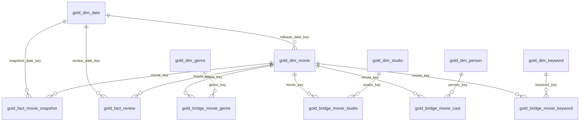

# Gold Layer Dimensional Model

The Gold layer is built by [`notebooks/phase3_gold_dimensional.ipynb`](../notebooks/phase3_gold_dimensional.ipynb).
It reads the Silver tables and produces a star schema with two fact tables, six conformed
dimensions, and four bridge tables that resolve the many-to-many relationships.

All objects live in `workspace.tmdb_lakehouse` and are stored as Delta tables.

## Design Summary

| Table | Type | Grain | Business key | Surrogate key |
|---|---|---|---|---|
| `gold_dim_date` | dimension | One row per calendar day | `full_date` | `date_key` |
| `gold_dim_movie` | dimension (SCD Type 2) | One row per movie per attribute version | (`movie_id`, `version`) | `movie_key` |
| `gold_dim_genre` | dimension (SCD Type 1) | One row per genre | `genre_id` | `genre_key` |
| `gold_dim_studio` | dimension (SCD Type 1) | One row per production company | `company_id` | `studio_key` |
| `gold_dim_person` | dimension (SCD Type 1) | One row per cast member | `person_id` | `person_key` |
| `gold_dim_keyword` | dimension (SCD Type 1) | One row per keyword | `keyword_id` | `keyword_key` |
| `gold_bridge_movie_genre` | bridge (factless fact) | One row per movie version × genre | (`movie_key`, `genre_key`) | — |
| `gold_bridge_movie_studio` | bridge (factless fact) | One row per movie version × studio | (`movie_key`, `studio_key`) | — |
| `gold_bridge_movie_cast` | bridge (factless fact) | One row per movie version × credit | (`movie_key`, `credit_id`) | — |
| `gold_bridge_movie_keyword` | bridge (factless fact) | One row per movie version × keyword | (`movie_key`, `keyword_key`) | — |
| `gold_fact_movie_snapshot` | fact (periodic snapshot) | One row per movie per snapshot date | (`movie_id`, `snapshot_date_key`) | `snapshot_key` |
| `gold_fact_review` | fact (transaction) | One row per review | `review_key` | `review_key` |

### Why these grains

- **`gold_fact_movie_snapshot`** is a *periodic snapshot* fact: every Gold run records the
  latest known state of every movie. Measures (`revenue`, `vote_average`, `review_count`, …)
  are additive or semi-additive at the snapshot-date grain, so trends work without re-reading
  Silver.
- **`gold_fact_review`** is a *transaction* fact: reviews arrive as events, each with its own
  date. Reviewer identity is a **degenerate dimension** (`reviewer_hash_id`) because the
  identifying attributes are not modelled.
- The four **bridge** tables resolve many-to-many relationships. A movie has many genres,
  studios, cast members, and keywords, so those links cannot live on the movie dimension
  without violating first normal form.

### Why `gold_dim_movie` is SCD Type 2

TMDB changes descriptive attributes over time (title corrections, runtime revisions, status
transitions, new budget tiers). Keeping history lets a fact row reference the version that was
true when the snapshot was taken, instead of silently rewriting the past. `gold_dim_movie` is
keyed by `movie_key = xxhash64(movie_id, version)`, and `attribute_hash` drives change
detection, so unchanged movies are never rewritten.

## Entity-Relationship Diagram



### Key relationships

| Child table | Column | References | Cardinality |
|---|---|---|---|
| `gold_dim_movie` | `release_date_key` | `gold_dim_date.date_key` | many-to-one |
| `gold_fact_movie_snapshot` | `movie_key` | `gold_dim_movie.movie_key` | many-to-one |
| `gold_fact_movie_snapshot` | `snapshot_date_key` | `gold_dim_date.date_key` | many-to-one |
| `gold_fact_review` | `movie_key` | `gold_dim_movie.movie_key` | many-to-one |
| `gold_fact_review` | `review_date_key` | `gold_dim_date.date_key` | many-to-one |
| `gold_bridge_movie_genre` | `movie_key` / `genre_key` | `gold_dim_movie` / `gold_dim_genre` | many-to-many |
| `gold_bridge_movie_studio` | `movie_key` / `studio_key` | `gold_dim_movie` / `gold_dim_studio` | many-to-many |
| `gold_bridge_movie_cast` | `movie_key` / `person_key` | `gold_dim_movie` / `gold_dim_person` | many-to-many |
| `gold_bridge_movie_keyword` | `movie_key` / `keyword_key` | `gold_dim_movie` / `gold_dim_keyword` | many-to-many |

Delta does not enforce foreign keys. These relationships are enforced by the notebook: the
fact and bridge loads inner-join the *current* version of `gold_dim_movie`, so an orphan key
cannot be written.

## Data Dictionary

### `gold_dim_date`

| Column | Type | Key | Description |
|---|---|---|---|
| `date_key` | INT | **PK** | `yyyyMMdd` integer, the join key used by every fact. |
| `full_date` | DATE | | Calendar date. |
| `day_of_month` | INT | | 1–31. |
| `month_number` | INT | | 1–12. |
| `month_name` | STRING | | Full month name. |
| `quarter_number` | INT | | 1–4. |
| `year_number` | INT | | Calendar year. |
| `day_of_week` | INT | | 1 = Sunday … 7 = Saturday (Spark `dayofweek`). |
| `day_name` | STRING | | Full weekday name. |
| `is_weekend` | BOOLEAN | | True for Saturday and Sunday. |

Covers 1900-01-01 to 2100-12-31 (73,414 rows). The notebook skips the merge when the table is
already complete.

### `gold_dim_movie` (SCD Type 2)

| Column | Type | Key | Description |
|---|---|---|---|
| `movie_key` | BIGINT | **PK** | Surrogate key for one version: `xxhash64(movie_id, version)`. |
| `movie_id` | BIGINT | natural key | TMDB movie identifier. |
| `title` | STRING | | Movie title as of this version. |
| `original_title` | STRING | | Original-language title. |
| `original_language` | STRING | | ISO language code. |
| `release_date` | DATE | | Parsed release date. |
| `release_date_key` | INT | **FK** → `gold_dim_date.date_key` | Release day. |
| `runtime` | INT | | Runtime in minutes. |
| `status` | STRING | | TMDB status (Released, Post Production, …). |
| `adult` | BOOLEAN | | Adult-content flag. |
| `budget_tier` | STRING | | `low` / `medium` / `high`, derived in Silver from budget. |
| `version` | INT | | Version number starting at 1. |
| `valid_from` | TIMESTAMP | | Snapshot timestamp when this version became current. |
| `valid_to` | TIMESTAMP | | When it was superseded; NULL while current. |
| `is_current` | BOOLEAN | | True for exactly one row per `movie_id`. |
| `attribute_hash` | STRING | | SHA-256 of the tracked descriptive columns, used for change detection. |

Tracked attributes for change detection: `title`, `original_title`, `original_language`,
`release_date`, `runtime`, `status`, `adult`, `budget_tier`. Measures such as budget, revenue,
and vote counts deliberately live in the fact table, so a revenue update does not create a new
dimension version.

### `gold_dim_genre`

| Column | Type | Key | Description |
|---|---|---|---|
| `genre_key` | BIGINT | **PK** | `xxhash64(genre_id)`. |
| `genre_id` | BIGINT | natural key | TMDB genre identifier. |
| `genre_name` | STRING | | Genre label. |

### `gold_dim_studio`

| Column | Type | Key | Description |
|---|---|---|---|
| `studio_key` | BIGINT | **PK** | `xxhash64(company_id)`. |
| `company_id` | BIGINT | natural key | TMDB production-company identifier. |
| `company_name` | STRING | | Company name. |
| `origin_country` | STRING | | ISO country code reported by TMDB. |

### `gold_dim_person`

| Column | Type | Key | Description |
|---|---|---|---|
| `person_key` | BIGINT | **PK** | `xxhash64(person_id)`. |
| `person_id` | BIGINT | natural key | TMDB person identifier. |
| `person_name` | STRING | | Latest known name of the cast member. |

### `gold_dim_keyword`

| Column | Type | Key | Description |
|---|---|---|---|
| `keyword_key` | BIGINT | **PK** | `xxhash64(keyword_id)`. |
| `keyword_id` | BIGINT | natural key | TMDB keyword identifier. |
| `keyword_name` | STRING | | Keyword label. |

### `gold_bridge_movie_genre`

| Column | Type | Key | Description |
|---|---|---|---|
| `movie_key` | BIGINT | **PK**, **FK** → `gold_dim_movie` | Movie version. |
| `genre_key` | BIGINT | **PK**, **FK** → `gold_dim_genre` | Genre. |

### `gold_bridge_movie_studio`

| Column | Type | Key | Description |
|---|---|---|---|
| `movie_key` | BIGINT | **PK**, **FK** → `gold_dim_movie` | Movie version. |
| `studio_key` | BIGINT | **PK**, **FK** → `gold_dim_studio` | Production company. |

### `gold_bridge_movie_cast`

| Column | Type | Key | Description |
|---|---|---|---|
| `movie_key` | BIGINT | **PK**, **FK** → `gold_dim_movie` | Movie version. |
| `person_key` | BIGINT | **FK** → `gold_dim_person` | Cast member. |
| `credit_id` | STRING | **PK** | TMDB credit identifier; distinguishes multiple roles. |
| `character` | STRING | | Character played. |
| `cast_order` | INT | | Billing position (0 = top billing). |

### `gold_bridge_movie_keyword`

| Column | Type | Key | Description |
|---|---|---|---|
| `movie_key` | BIGINT | **PK**, **FK** → `gold_dim_movie` | Movie version. |
| `keyword_key` | BIGINT | **PK**, **FK** → `gold_dim_keyword` | Keyword. |

### `gold_fact_movie_snapshot`

| Column | Type | Key | Description |
|---|---|---|---|
| `snapshot_key` | BIGINT | **PK** | `xxhash64(movie_id, snapshot_date_key)`. |
| `movie_key` | BIGINT | **FK** → `gold_dim_movie` | Movie version current at the snapshot. |
| `movie_id` | BIGINT | degenerate | Natural key, kept for joining without the dimension. |
| `snapshot_date_key` | INT | **FK** → `gold_dim_date` | Date of the snapshot. |
| `batch_id` | STRING | | Silver batch that produced this snapshot. |
| `source_extracted_at` | TIMESTAMP | | TMDB extraction time of the snapshot. |
| `popularity` | DOUBLE | measure | TMDB popularity. |
| `vote_average` | DOUBLE | measure | Average rating. |
| `vote_count` | BIGINT | measure | Number of votes. |
| `budget` | BIGINT | measure | Budget in nominal USD; NULL when unknown. |
| `revenue` | BIGINT | measure | Revenue in nominal USD; NULL when unknown. |
| `profit` | BIGINT | measure | Revenue − budget. |
| `roi` | DOUBLE | measure | (Revenue − budget) / budget. |
| `review_count` | BIGINT | measure | Number of stored reviews. |
| `avg_review_rating` | DOUBLE | measure | Mean review rating. |
| `cast_count` | BIGINT | measure | Distinct credited cast members. |
| `genre_count` | BIGINT | measure | Distinct genres. |
| `studio_count` | BIGINT | measure | Distinct production companies. |
| `keyword_count` | BIGINT | measure | Distinct keywords. |
| `load_timestamp` | TIMESTAMP | | Gold write time. |

### `gold_fact_review`

| Column | Type | Key | Description |
|---|---|---|---|
| `review_key` | BIGINT | **PK** | `xxhash64(movie_id, review_id)`. |
| `movie_key` | BIGINT | **FK** → `gold_dim_movie` | Movie version current at load time. |
| `movie_id` | BIGINT | degenerate | Natural movie key. |
| `reviewer_hash_id` | STRING | degenerate dimension | Salted reviewer hash from Silver; never a raw identity. |
| `review_date_key` | INT | **FK** → `gold_dim_date` | `created_at` day, falling back to `updated_at`. |
| `rating` | DOUBLE | measure | Reviewer rating. |
| `weeks_since_release` | INT | measure | Whole weeks between release and review. |
| `batch_id` | STRING | | Silver batch that supplied the review. |
| `source_extracted_at` | TIMESTAMP | | TMDB extraction time. |
| `load_timestamp` | TIMESTAMP | | Gold write time. |

## Refresh Strategy

| Object | Strategy | Reason |
|---|---|---|
| `gold_dim_date` | Insert-only `MERGE` on `date_key` | Static calendar; regenerated only when incomplete. |
| `gold_dim_movie` | SCD Type 2 (`MERGE` close + `MERGE` insert) | Preserves attribute history. |
| `gold_dim_genre/studio/person/keyword` | SCD Type 1 `MERGE` on the natural key hash | Names are corrected in place; no history is needed. |
| Bridge tables | Delete links of current versions, then insert-only `MERGE` | Silver replaces a movie's child collections, so removals must propagate; historical versions keep the links they had. |
| `gold_fact_movie_snapshot` | Upsert `MERGE` on `snapshot_key` | Same-day reruns update instead of duplicating. |
| `gold_fact_review` | Upsert `MERGE` on `review_key` | Reviews can be edited upstream. |

Rerunning the same `batch_id` is idempotent: dimensions and facts produce zero inserts and
zero updates, and the bridges are rebuilt with identical content for the current movie
versions.

## Pipeline Integration

`phase2_incremental_autoload.ipynb` runs Gold as the last step:

```
fetch → Raw-to-Bronze → Bronze-to-Silver → Silver child tables → Silver reviews → Gold
```

The `run_gold` widget (default `true`) controls it; Gold only runs when `run_silver=true`,
because it reads the Silver tables the run just produced. The batch id is passed through, so
`pipeline_execution_logs` ties Bronze, Silver, and Gold rows to the same batch.

Standalone re-run:

```python
dbutils.notebook.run("./phase3_gold_dimensional", 7200, {"batch_id": "<batch-id>"})
```

## Execution Logging

Gold appends one `pipeline_execution_logs` row per table, with `layer = 'Silver-to-Gold'`:

| Column | Gold meaning |
|---|---|
| `layer` | `Silver-to-Gold` |
| `input_parameter` | `<step>: <source tables>` |
| `batch_id` | Batch that triggered the run. |
| `start_time` / `end_time` | Wall-clock execution time of that step. |
| `status` | `SUCCESS` or `FAILURE`. |
| `rows_inserted` / `rows_updated` | Rows produced by the step, parsed from Delta `DESCRIBE HISTORY` operation metrics. Their sum is the number of aggregated Gold rows written. |
| `error_details` | Failure message, truncated to 4,000 characters. |

The Phase 2 log schema is reused unchanged (`rows_inserted`, `rows_updated`,
`rows_quarantined`, …), so Silver and Gold rows share one audit trail and can be compared with
`WHERE layer = 'Silver-to-Gold'`.

## Performance Optimization

- **Liquid clustering** is declared on the larger tables:
  `gold_dim_movie CLUSTER BY (movie_key)`,
  `gold_fact_movie_snapshot CLUSTER BY (snapshot_date_key, movie_key)`,
  `gold_fact_review CLUSTER BY (review_date_key, movie_key)`,
  `gold_dim_date CLUSTER BY (date_key)`.
  The notebook falls back to a plain Delta table if the runtime does not support the syntax.
- **`OPTIMIZE`** runs for every Gold table after the load (`run_optimize` widget). With liquid
  clustering, `OPTIMIZE` compacts files and re-clusters incremental data; no `ZORDER BY` is
  needed.
- **Predicate-friendly keys**: facts carry both the surrogate (`movie_key`) and the natural
  (`movie_id`) key, and a `yyyymmdd` integer date key, so BI filters prune files without
  functions on the partition column.
- **Incremental dimensions**: SCD1 merges only rewrite rows whose attributes actually changed,
  and `gold_dim_movie` compares a hash instead of all columns.

## Query Examples

Top genres by revenue:

```sql
SELECT g.genre_name,
       COUNT(DISTINCT f.movie_key) AS movies,
       ROUND(SUM(f.revenue) / 1000000.0, 1) AS revenue_musd,
       ROUND(AVG(f.vote_average), 2) AS avg_vote
FROM workspace.tmdb_lakehouse.gold_fact_movie_snapshot f
JOIN workspace.tmdb_lakehouse.gold_bridge_movie_genre b ON b.movie_key = f.movie_key
JOIN workspace.tmdb_lakehouse.gold_dim_genre g ON g.genre_key = b.genre_key
GROUP BY g.genre_name
ORDER BY revenue_musd DESC NULLS LAST;
```

Top billed cast for a movie:

```sql
SELECT p.person_name, c.character, c.cast_order
FROM workspace.tmdb_lakehouse.gold_bridge_movie_cast c
JOIN workspace.tmdb_lakehouse.gold_dim_person p ON p.person_key = c.person_key
JOIN workspace.tmdb_lakehouse.gold_dim_movie m ON m.movie_key = c.movie_key
WHERE m.movie_id = 550 AND m.is_current = true
ORDER BY c.cast_order;
```
